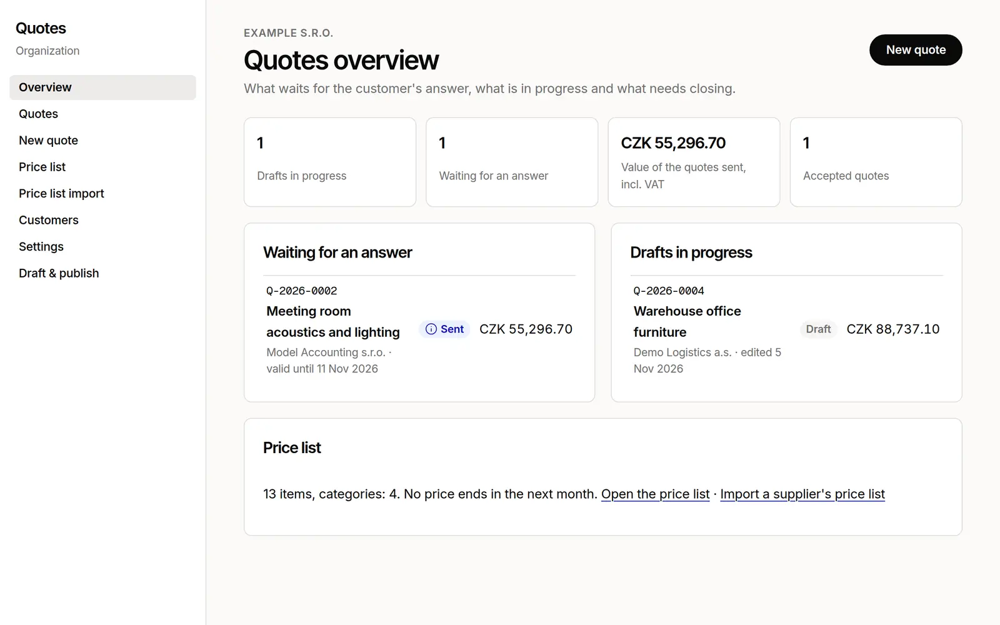

# Quotes

A price list and customer quotes for a Lazurio Organization: the App, the data
and the process its agents follow. Quotes is a Module of the
[Lazurio Module Standard](https://github.com/Lazurio/LazurioPlatform/blob/main/docs/module-standard.md)
and a template of the Lazurio Marketplace, published by LazurioTemplates as the
public upstream `LazurioTemplates/quotes` under the MIT license. In Czech it is
called „Cenové nabídky“.



- **Price list.** Items with a code, a category, a unit, a purchase and a sale
  price without VAT, a VAT rate and the dates a price is valid. Every change of
  a price goes into the item's price history, by hand or from an import.
- **Supplier price lists.** A supplier's CSV (`;`, `,` or tab, UTF-8 or
  Windows-1250) is read against the price list: a preview shows every new,
  changed and invalid row and the supplier's items the file lacks, and only the
  rows a person keeps are written, with a markup and rounding they choose.
- **Quotes.** A customer from the Module's own contacts, lines from the price
  list or outside it, quantities with decimals, a discount per line and on the
  whole quote, VAT per rate (21, 12 and 0 % by default, all data), subtotals
  and totals, numbers in a format of the Organization's choice, a validity
  date, the states draft → sent → accepted, rejected or expired, and a new
  version after a quote went out. Amounts are whole haléře, never floating
  point.
- **For the customer.** A print page in the look of the Organization's design
  system, printed or saved as PDF by the browser, and the e-mail text to send
  with it. Sending is the person's step; the App and its agents only prepare it.
- **For agents.** Three skills (`.agents/skills/`): prepare a quote from an
  inquiry, update the price list from a supplier's price list, check a quote
  before it goes out. They work through `bun run quotes`, the same service the
  App uses, and the App offers the same actions as WebMCP tools.
- **Draft & Publish.** Every save is a draft; a person reviews the changed
  records in business language and publishes them as one change to the
  Organization's data repository, or returns them.

The App speaks Czech or English, the language of the person's Lazurio profile.
The records hold whatever language the Organization writes in; both starts
ship in both languages.

## How it is built

| | |
| --- | --- |
| App generation | `app/v3`: data in [repository-db](https://github.com/Lazurio/repository-db) |
| Stack profile | [`app-data@2026.11`](https://github.com/Lazurio/LazurioPlatform/blob/main/docs/stack-profiles.md#app-data): Bun 1.4.4, TypeScript 7.0.2, Vite 8.3.5, React 19.3.1, Biome 2.6.4, Zod 4.6.7, `@lazurio/repository-db` v3.2.6, `@lazurio/module-kit` v0.2.0, exact versions only |
| Data | the Organization's own repository `quotes-data`, branch `v3`, checked out as `db/` |
| Shape of the data | Zod schemas in `app/v3/src/domain/`; the JSON Schemas of the data repository are generated from them |
| Look of the quote | `design-system/`: release v1.0.0 of [LazurioTemplates/design-system](https://github.com/LazurioTemplates/design-system), merged as a subtree |

```text
app/v3/src/
  domain/     Zod schemas and pure logic: money, totals, numbers, states, checks, the import
  data/       the storage port (store.ts), its repository-db and memory implementations
  service/    the operations the API and the command line share
  server/     Bun.serve: the HTTP API over the port, the print page, health, the client
  ui/         React; talks only to the HTTP API; WebMCP tools
  document/   the quote as the customer receives it
  cli/        bun run quotes, validation, schema export
  i18n/       the two languages
app/v3/seed/<cs|en>/<empty|sample>/   the starts, laid out like db/data/
app/v3/tests/store-contract.ts        the shared test suite every store implementation passes
templates/data-repo/                  the data repository an adopting Organization starts from
design-system/                        the design system release the quote document follows
.agents/skills/, .claude/skills/      the process for agents (the same files for Codex and Claude Code)
```

The server never runs Git on the data and never reads a record file by a path
it built: every read and write goes through the storage port, which in `v3`
is repository-db's sync host. Generation `v4` (Dolt) replaces only that port
implementation; see [`docs/extending.md`](docs/extending.md).

## Run it

Lazurio starts the App from its Module manifest: `lazurio module start
<Organization>/quotes`. To work on it in a worktree:

```bash
cd app/v3
bun install --frozen-lockfile
bun run check          # typecheck, Biome, generated schemas, the starts, tests
LAZURIO_RUNTIME_LISTENER_APP_HOST=127.0.0.1 LAZURIO_RUNTIME_LISTENER_APP_PORT=<free port> bun run dev
```

`bun run dev` serves the data checkout `db/` at the Module root. Without one,
the App runs and says that the data is not available yet.

`bun run dev:demo` (or `bun run dev:demo en`) serves the fictional example in
memory instead: nothing is read from or written to a repository, and every
change is gone when the process ends. Outside Lazurio, add `?lang=en` to the
address for the English interface. The Marketplace screenshots come from it.

| Script | Does |
| --- | --- |
| `check` | the one gate: `typecheck`, `lint`, `schema:check`, `validate:data`, `bun test` |
| `quotes` | the agent's command line, see [`docs/agents.md`](docs/agents.md) |
| `validate:db` | checks the data checkout `db/` (draft included) against the schemas and the rules across records |
| `schema:export` | regenerates `templates/data-repo/schemas/*.schema.json` from the Zod schemas |
| `build` | the client build of the built version (`dist/`) |

## Adopt it

The Marketplace in Lazurio hands an agent a brief; the agent follows
[`docs/adoption.md`](docs/adoption.md): it checks rights and name collisions,
creates a private Module with its data repository by `lazurio module create
--data`, merges the released commit so it stays an ancestor, prepares the data
in the person's language and opens pull requests. Nothing is merged, published
or sent without the person's instruction.

## Documents

- [`AGENTS.md`](AGENTS.md): rules for agents working on this repository and in an adopted Module
- [`docs/adoption.md`](docs/adoption.md): taking the template into an Organization
- [`docs/extending.md`](docs/extending.md): changes within the generation, the look of the quote,
  sending through an Integration, taking template updates, stack profile releases, the move to `v4`
- [`docs/data.md`](docs/data.md): the records, money in haléře, the data repository and its validator
- [`docs/agents.md`](docs/agents.md): `bun run quotes` and the WebMCP tools
- [`CHANGELOG.md`](CHANGELOG.md), [`SECURITY.md`](SECURITY.md), [`CONTRIBUTING.md`](CONTRIBUTING.md), [`NOTICE.md`](NOTICE.md)

## License

MIT, see [`LICENSE`](LICENSE).
